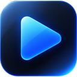
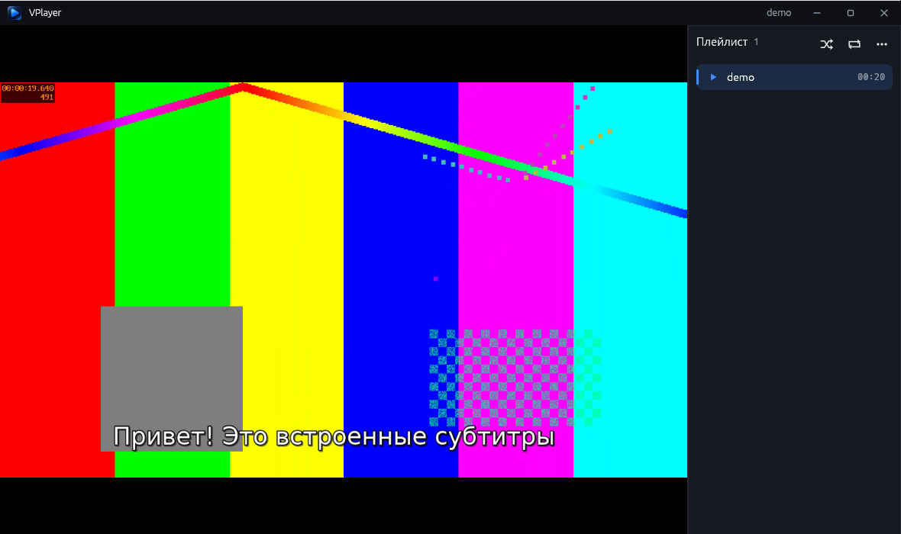
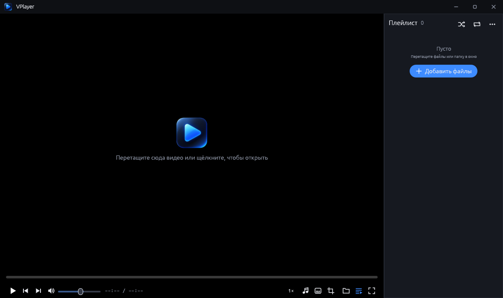
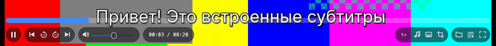

<div align="center">



# VPlayer

**Простой видеоплеер без лишнего. Только то, что нужно, чтобы смотреть.**

Тёмный современный интерфейс, движок VLC внутри, одна программа для Windows, Linux, Android и Android TV.




</div>

## Идея

VLC умеет открыть почти что угодно, но его интерфейс перегружен десятками меню и настроек, которые нужны единицам. VPlayer берёт тот же движок (libVLC) и оставляет вокруг него только самое нужное: открыть файл, смотреть, переключить дорожку или субтитры, продолжить с того же места.

- **Без лишнего.** Нет медиатеки, скинов, визуализаций, бесконечных настроек. Все кнопки помещаются в одну панель.
- **Не мешает смотреть.** Кнопки висят поверх видео в полупрозрачных капсулах и прячутся вместе с курсором, пока фильм идёт.
- **Открывает всё, что открывает VLC.** mkv, mp4, avi, mov, webm, ts, сетевые потоки, встроенные и внешние субтитры.
- **Помнит, где вы остановились.** Каждое видео продолжается с того же места.

## Скриншоты

<table>
<tr>
<td width="50%"><br><sub>Стартовый экран: перетащите видео в окно или щёлкните, чтобы открыть</sub></td>
<td width="50%"><br><sub>Воспроизведение с субтитрами и плейлистом</sub></td>
</tr>
<tr>
<td colspan="2"><br><sub>Панель управления поверх видео, без затемнения кадра</sub></td>
</tr>
</table>

## Возможности

| | |
|---|---|
| ▶️ **Плейлист** | файлы, папки, ссылки (http, rtsp, udp…), перетаскивание в окно, повтор и перемешивание, M3U |
| ⏯️ **Продолжение просмотра** | каждое видео продолжается с места остановки; громкость и устройство тоже запоминаются |
| 🔊 **Звук** | выбор дорожки и устройства вывода (колонки, наушники, HDMI), громкость до 150 %, задержка звука |
| 💬 **Субтитры** | встроенные дорожки и внешние файлы (srt, ass, ssa, vtt, sub…), задержка субтитров |
| ✂️ **Кадрирование** | 16:9, 4:3, 2.39:1 и другие пропорции, ручная обрезка краёв |
| ⏩ **Скорость** | от 0.25× до 3× |
| 🖥️ **Окно** | своя тёмная рамка, полный экран, кнопки под превью на панели задач Windows |
| ⌨️ **Горячие клавиши** | пробел, стрелки, M, F, L и другие (полный список в [windows/README.md](windows/README.md#горячие-клавиши)) |

### На Android дополнительно

- 📁 встроенный браузер файлов: память телефона, SD-карта, USB;
- 🌐 локальная сеть: DLNA/UPnP-серверы и общие папки SMB находятся сами;
- 👆 жесты: двойное касание для перемотки на 10 с, свайпы для яркости, громкости и перемотки;
- 🔲 масштаб «под экран» и автоматическое удаление чёрных полос, вшитых в видео;
- 🪟 окно поверх других приложений при сворачивании;
- 🕘 список недавних файлов.

Подробности в [android/README.md](android/README.md).

### На Android TV

Отдельное приложение **VPlayer TV** для телевизоров и приставок Android TV / Google TV, всё управляется пультом:

- 📺 главный экран с плитками «Файлы», «Сеть», «Ссылка» и рядом «Продолжить просмотр»;
- 💾 USB-флешки и жёсткие диски, DLNA и SMB в локальной сети;
- 🎮 кнопки пульта и геймпада: пауза, перемотка, следующий файл;
- 🌈 аппаратное декодирование 4K и вывод HDR10 на телевизор как есть;
- ⌨️ своя экранная клавиатура (русская и английская раскладки).

Подробности в [android-tv/README.md](android-tv/README.md). Версия ещё дорабатывается, в первую очередь воспроизведение 4K HDR.

## Что в репозитории

Это форк [VLC](https://code.videolan.org/videolan/vlc). Исходный код самого VLC не изменён и лежит в ветке [`master`](../../tree/master), а в этой ветке находится только плеер:

| Папка | Что внутри |
|---|---|
| [`windows/`](windows/) | настольная версия: Windows, Linux (и macOS, не проверялась) |
| [`android/`](android/) | версия для Android 7+ (arm64) |
| [`android-tv/`](android-tv/) | версия для Android TV / Google TV 7+ (ARM 32 и 64 бита) |

Весь код плеера написан на Rust, интерфейс сделан на egui. К libVLC плеер обращается напрямую через C API, без Java на Android и без C++.

## Сборка

**Windows / Linux**

```sh
cd windows
cargo build --release
```

Для Linux нужен `libvlc-dev`, для Windows папка с `libvlc.lib` в `VLC_LIB_DIR`. Скрипт `installer/build-windows.sh` собирает установщик и переносную версию.

**Android**

```sh
cd android
ANDROID_HOME=/путь/к/sdk bash android/build-apk.sh
```

**Android TV**

```sh
cd android-tv
ANDROID_HOME=/путь/к/sdk bash android/build-apk.sh
```

Полные инструкции в README каждой папки.

## Лицензия

GPL-2.0-or-later. Плеер использует libVLC от [VideoLAN](https://www.videolan.org/) (LGPL-2.1+) без изменений: готовую сборку для Android (`org.videolan.android:libvlc-all`) или установленный VLC на компьютере. Плеер только передаёт libVLC параметры запуска из своего кода, например включает аппаратный декодер и вывод видео на Android TV.
